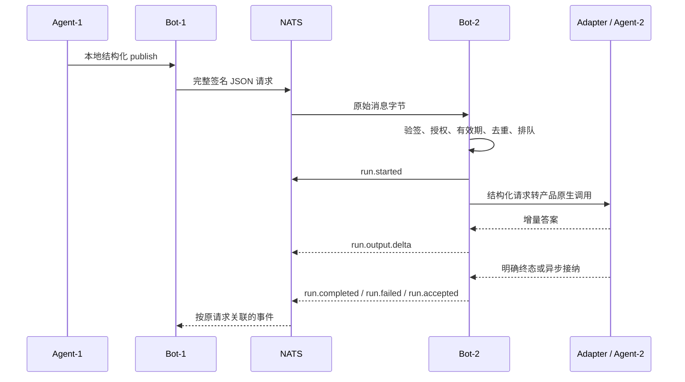

# ClawSynapse Messaging

最后更新：2026-11-09

## 协议边界

本文说明已实现的消息使用与数据流。字段、subject、签名编码见 [协议文档](./protocol.md)，本地访问保护见 [API 文档](./api.md)，产品事件契约见 [集成与适配](./integration.md)。

## 在线投递模型

Bot 之间使用 NATS JetStream 持久 inbox，每条请求或事件是一个完整签名 JSON 对象。Messaging 与 Discovery 使用 wire v2，不接收旧版封套，也不自动降级；升级时必须协调所有 Bot 与直接集成调用方。同 daemon 的 Bot 也有独立身份/NATS 上下文，不共享认证与信任。

- 本地 HTTP 使用 `/v2/bots/{botId}/…`，没有 v1 别名或默认 Bot；目标字段是 `targetBot`，本地身份是 `botId`。wire v2 的 `from`/`to`、签名、subject 不因多 Bot 改名。
- 请求正文使用 `payload.text` 或 `payload.instruction/input`，不使用网络 content；本地 API 的 message 是 payload.text 快捷输入，不能与 payload 同时提交。
- 发布先以 fsync 记录到所选 Bot 的持久 outbox；HTTP 成功说明 JetStream 已确认接纳，不表示对端业务接纳或模型完成。JetStream 不可用不降级到 Core NATS。
- 网络错误可能发生在持久记录之后；同一 intent 仍会从 outbox 发送。HTTP 调用方使用稳定 idempotencyKey 重试，不换新 key 重发副作用；同 key 不同内容拒绝。API 失败不是“肯定没执行”。
- 日志只记录关联标识与阶段，不默认记录请求正文；持久消息日志包含正文，应按私有业务数据备份和控制权限。

## Bot 发现与消息入口

每个 running Bot 加载自己的 Ed25519 身份，建立独立 NATS 连接，订阅自身 inbox、发现及控制 subject，并发布签名 announce、周期续租。daemon manager 共享资源但不承担统一网络身份；catalog 中 stopped/archived 的 Bot 不主动上线。

接收 announce 时校验版本、派生身份、完整签名、时效和重放记录；lastSeenMs 取本地接收时间。只有已知 Bot 的有效签名 depart 才会驱逐其发现记录，异常退出通过 TTL 清理。自报能力不直接授予权限。

首次通信应对显式选择的本地 Bot 调用 auth API/CLI 完成握手，再请求并批准信任。不能假设 publish 会自动建立首次认证/信任；正常模式下未认证或未受信任目标拒绝。A 的信任或 alias 不会被 B 继承，即便它们共用 daemon。

## 结构化请求与执行事件

下图只描述 Agent Role 的执行路径；Console 的收件与拒绝见下方约定。

- `requestId` 指向原请求消息 ID；`runId` 由接收 Bot 生成；`seq` 在单次执行中从 1 递增。
- Codex/OpenCode 原生 JSONL 被 Adapter 增量解析，每个归一化事件再成为一条独立 NATS 消息。OpenClaw Gateway JSON 响应是一次性结果，不宣称原生流式输出。
- delta 仅承载允许发布的答案，不直接透传思考、工具参数和原生 stderr。
- 明确终态不会再次附带已经发出的完整答案；消费者不要重复追加。
- `run.accepted` 仅表示异步接纳，产品运行标识放在 `payload.adapterRunId`；后续结果依赖权威端查询。
- 超时、取消或失败可能发生在副作用之后。`payload.indeterminate=true` 时不自动重新执行原动作。
- 原生 `run.failed` 可携带固定安全摘要 `payload.message`（可选、最多 512 字节）；不包含 native stdout/stderr、原始错误、凭据或提示词。分类仅读取明确的结构化 error 字段，不搜索整条 JSON，`sessionID` 加上 `error.type=unknown` 不等于会话丢失。
- 已知拒绝分别为 `invalid_model / validation`、`provider_quota / provider`（含 `provider.free-limit`）、`provider_auth / authentication`、`session_unavailable / session_load`。尚无推理、答案或工具活动证据时才可为确定失败；出现这些活动后仍保留 `indeterminate=true`。传输失败为 `native_transport / transport`，未知运行时错误为 `native_failed / execution`，均保留不确定性，不自动重试业务或新建会话。
- run 事件不进入 LLM，也不产生反馈回复；Webhook 可以消费这些事件。
- Console Bot 的 `chat.message` 与反馈只提交持久 inbox，不执行模型、不创建虚假 Run、不 echo 或生成 completed。执行请求在公共校验和持久收件后、执行 admission 前拒绝：未过期为 `run.failed`、`payload.code="console.execution_unsupported"`、`indeterminate=false`；过期为 `execution.expired`。保留 requestId/runId/seq/Session 和签名关联，不发 started、accepted、答案或 completed，不占用 Bot/daemon Harness 预算。拒绝终态与工作结果先持久提交，再由 outbox 发布；重复投递/重启只恢复原事件。历史已 admitted 请求仍按不确定性恢复，不伪装为从未执行。Console 正常发布聊天并接收 Agent 答案，Harness 健康为不适用，不是人工任务执行器。
- 文件传输属于公共通信：`transfer.available` 仍经过授权、配额及持久引用处理；本地 `transfer.received` 回调按 Role 分派。Console 只保存可恢复记录和授权引用，不调用 Harness、不生成执行反馈；桌面关闭不影响 daemon 收件，重开通过原 cursor 和文件读取 API 查看。Agent 保留文件通知与工作副本契约，不自动重放已 admitted 通知。

### 当前工作进展

执行中的 Agent 可通过原 publish CLI 报告 `chat.progress`，而不是把进展混入答案。
daemon 只允许精确关联当前 admitted 原请求/Run、原发送 Bot、Agent 及会话；
queued、过期和终态后的新进展拒绝。正文是一句单行可见工作（最多 512 UTF-8 字节），
不是工具原文、思考、历史或完成结果。命令和真实执行上下文见 [integration.md](integration.md)。

进展和 run.* 各有独立的正递增 seq 与 outbox 前序依赖；进展签名、幂等和排序
在同一次持久提交中写入，不改变 run 序号。网络重试/重启重发同一 ID；
同 key 同正文可取回已终结请求的原进展记录，不能创建新进展。
Agent/Console 均只持久收件，进展绝不调用 Harness（包括 Webhook），不占用执行预算、
不产生 ACK/答案/run 反馈。客户端按 messages cursor 恢复，以精确关联和 seq
选当前进展；终态优先，旧进展不能覆盖完成或失败。
requests 查询的 events 仍专属 run.*，进展不成为会话历史或最终答案。

Workspace `metadata.clawsynapseReplyMode="chat"` 的答案单独处理：native Adapter
按 assistant 消息与工具轮次边界选取权威最终 assistant 消息，不拼接前序工具轮叙述，
不把当前累计流文本在 completed 时冒充最终答案。候选正文只在本次调用确认成功、
原生会话持久化成功后发布；失败/不确定时不发布候选。普通 peer 请求的流式契约保持不变。
工作过程只通过 chat.progress 更新，不进入中央会话或最终答案；此处不做关键词过滤。

### Workspace 增量上下文

新主题发送 `payload.text` 本轮指令和 `payload.input` 的 topic-turn/1 数据，
不再将固定规则与全部 history 拼成字符串。发送方先以非执行 chat.context
同步公开事实并核对持久收执，再发送执行；旧端无正确收执时不会收到 delta-only
任务。事件追加版本包含旧问题后来完成的回复，未完成输出不进入公开事实。

详细字段、摘要和恢复不变量见[主题公开上下文增量协议](protocol.md#主题公开上下文增量协议)。
模型收到语义 `{instruction,publicContext,requiredContext?}`；接收端策略来自
本地可信配置，运行标识留在调用环境。已有原生输入/自己的 completed 回复
通过请求来源关联去重，不再次装入。延后必需范围通过当前请求 reader 分页。

公开事实的 storedThrough 收执、原生装入账本和 Run 终态是不同证据；
一个 stdout user 事件或相同 Session UUID 不代表上下文已经持久完整。
不确定请求暂停该原生代际后续工作，直到对账或显式使用新上下文。
策略和 reader 不增加工具权限；工具不可用、必需上下文未读完时不声称成功。

## 有界执行与会话

- 每 Bot 保留固定串行工作分片，同发送方、Agent、会话进入同一分片，不相互越序；不同会话可能保守串行。
- 只有 Agent 的 maxQueued/maxConcurrent 与 daemon Harness maxConcurrent 用于有界执行；Console 不配置或占用这些执行资源。公共收件排序和文件限制不等同于执行队列。过载明确失败，排队后及等待预算后再次检查有效期与授权；配置不意味着无界 goroutine 或执行池。
- 请求默认有效 10 分钟，最大 10 分钟；更短业务显式 expiresAt。已持久排队但过期的命令不启动 Harness。
- LLM 产品会话按本地 Bot、bindingRevision、产品、发送方、目标 Agent 和会话键隔离；原生 CLI 使用各 Bot 绑定 workspace 作为 cwd，并传入该 Bot model。旧会话失效明确报错，不静默新建重跑。
- daemon 关停取消在途执行，CLI runner 有界输出并管理进程树。显式 Bot stop 仅停止该 Bot；daemon 关闭保留 catalog desiredState，重启按它恢复。

## 恢复与生产边界

每个 Bot 独立的 `state/messages.jsonl`（0600）是持久 journal，不是纯内存 recent ring。fsync 提交发布幂等键、outbox、收件箱 cursor、去重记录及 queued/admitted/done 工作；进程崩溃只允许截掉未提交的最后不完整 append，不忽略中间损坏。journal 独占锁避免两个 runtime 同时写同一 Bot 状态。

- queued 工作恢复后仍需检查授权/有效期；未启动执行的过期请求确定失败。
- 崩溃前已经 admitted 的执行不能证明副作用是否发生；恢复发出 run.failed，code=execution.interrupted、stage=restart、indeterminate=true，不自动重新调用模型或外部动作。反馈和文件处理按非模型执行语义恢复，不构成副作用 exactly-once 承诺。
- 执行事件先写本地 outbox，broker 故障由同一事件 ID 重试，不因结果尚未发布而再次执行模型。
- `GET /v2/bots/{botId}/messages?after=CURSOR&limit=100` 按本地持久游标回放，limit 1–1000，默认无 after 返回最近 100 条。消费者按 Bot 保存成功消费的 cursor；seq 检测单 run 缺口，不能代替 cursor，也不能自行补全。
- `GET /v2/bots/{botId}/requests/{messageId}` 查询持久发布/执行状态。accepted 只代表异步接纳；indeterminate 必须查询执行 authority 或人工对账，不自动重跑。
- 文件接收的引用先持久提交，pending 本地通知有自己的 admission 状态；callback 前记 admitted，崩溃后的 admitted 通知不自动回调重放。引用恢复/可读不代表通知已处理，更不代表外部动作完成。
- 文件引用恢复同样 fail closed：catalog 或已注册 Bot/引用目录缺失不能当作空历史。GC 在核验完整 catalog 和所有注册 Bot（含 stopped/archived）的引用根后才允许回收；运行时不能通过自动建空 transfers 目录“修复”授权记录丢失，应保留证据并核对一致性备份。

持久挂载并备份完整 DataDir；当前 journal 不自动裁剪，需规划磁盘。JetStream 共享消息保留 7 天，本地已接收历史不随它裁剪；超过 broker 保留期且本地尚未收到的数据不保证可回放。发现新鲜度仍不是执行日志。持久去重不等于业务 exactly-once，也不承诺无限离线投递或无限保留。文件按 Bot 持久引用授权，下载/转发必须使用 Bot-qualified API，不暴露共享内容路径。

设备审批、远程启动及文件接收凭据仍需由目标业务系统定义并验证；通信执行终态不能代替设备端凭据或业务授权。
