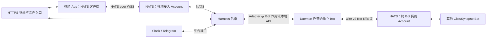

# Harness 移动端 NATS 接入设计

最后更新：2026-10-31

## 文档状态与范围

本文记录移动端接入方案的讨论结论，属于**待实现的设计建议**，不代表当前 ClawSynapse 已提供移动接入、凭据签发或历史同步能力。文中的 subject 和消息字段均为建议，尚未成为稳定协议。

本文只讨论：

- 移动 App 与 Harness 后端如何通信。
- 如何复用 NATS，避免手机安装独立 daemon 或承载 Bot。
- Harness 与 ClawSynapse 的职责，以及移动端认证、权限和恢复语义。

**Harness 内部多个 Agent 如何调度、执行或互相通信，不属于本文范围。**

现有接入方式见 [集成与适配](./integration.md)，Bot 间协议见 [协议文档](./protocol.md)。本文不会修改既有 Bot 间协议。

## 设计结论

采用以下组合：

> HTTPS 登录与文件传输 + NATS over WSS 双向业务消息 + Harness 后端持久记录与重连同步。

移动 App 内置 NATS 客户端库，直接连接 NATS Server 的 WSS 入口。手机不运行 NATS Server，不安装 `clawsynapsed`，也不承担 ClawSynapse Bot 的发现、认证和信任管理职责。移动接入本身仍是待实现方案，不因多 Bot 本地管理已落地而变为可用功能。

这不是完全取消 WebSocket，而是**用 NATS 协议替代自定义业务 WebSocket 协议，底层仍使用 WSS**。在已有 NATS 基础设施的前提下，可以避免再增加一个只转发消息的 WebSocket 网关。

不要求全部通信都使用 NATS。登录、OAuth 回调和文件传输继续使用 HTTPS；Slack、Telegram 等渠道继续通过平台官方接口接入 Harness 后端。

## 部署结构与职责



移动接入与跨 Bot 网络可以共用一套 NATS Server 部署，但应使用独立 Account 隔离 subject 命名空间和权限。不要直接向手机开放现有 Bot 网络。

| 角色 | 职责 |
|---|---|
| 移动 App | 用户交互、提交命令、接收事件、审批交互、重连同步 |
| NATS | 连接管理、发布订阅、Request-Reply、subject 级权限执行 |
| Harness 后端 | 用户与设备绑定、业务授权、会话管理、命令去重、持久记录、事件路由 |
| ClawSynapse Daemon / Bot | daemon 托管多个独立 Bot；各 Bot 分别负责身份、发现、认证、信任与消息交换 |
| Slack / Telegram 接入 | 平台消息收发、渠道账号绑定、平台会话与 Harness 会话映射 |

一个 daemon 可以托管多个长期协作身份 Bot，每个 Bot 独立持有 Ed25519 密钥、DID、信任、消息和文件引用。当前显式 Role 为 `console`／`agent`：只有 Agent 配置 Harness 和 Session 映射，Console 持久收件但不执行；`device` 尚不可创建。Harness 内部 Agent、subagent 和 Session 不自动成为 Bot 或联系人；多个手机和渠道可访问经后端授权的 Bot，不需要分别部署 daemon。此角色实现不代表本文移动接入方案已交付。

`botId` 沿用 Ed25519 → `did:key` → `n1-<hash>` 算法，与 wire v2 `nodeId` 是同一值；此本地分层不改 `nodeId/from/to`、subject、签名或 consumer。信任按 Bot 而非 daemon 共享；A 信任 R 不授予 B 信任或文件权限。`agentId` 只作所选 Binding 内的受限路由提示，不等于 Agent 级/租户级授权。共享进程和同 OS 用户不构成强多租户沙箱。

## 移动端连接流程

1. App 通过现有 HTTPS 登录，后端确认用户及设备身份。
2. 后端通过支持动态授权的 NATS 认证方案签发或换取受限连接凭据，并绑定用户、设备和权限；不得把服务器管理凭据或 Account 签名私钥发给 App。
3. App 使用凭据连接 `wss://` 入口。
4. App 先订阅自己的事件与回复 inbox，再提交命令或发起同步。
5. 凭据过期、设备撤销或权限变化时，按所选认证方案续期、撤销或断开连接。

NATS 凭据不能作为“客户端已经获准执行所有业务操作”的证明。Harness 后端仍需校验会话访问权和操作权限，并将请求关联到服务器授权的身份，不能相信消息正文中自报的用户 ID。

移动凭据代表用户/设备的移动入口权限，不是 Bot 的 Ed25519 身份或 Bot 本地 HTTP token。后端必须将用户操作映射到其被授权的 Bot 与会话；不能让手机通过自报 `botId` 取得另一个 Bot 的身份或文件引用。Harness 调用本地 API 时可使用对应 Bot 的作用域凭据及 `/v2/bots/{botId}/...`；daemon 仅监听 loopback，无 token 请求即可完整管理，本机任意进程均可如此调用，故 scoped token 不是本机进程隔离。不要向设备暴露或代理本地管理 API；跨设备通信使用 NATS。

## 消息 Interface

### Subject 建议

```text
app.v1.<userId>.<deviceId>.commands
app.v1.<userId>.<deviceId>.events
客户端专属 reply inbox
```

`userId` 和 `deviceId` 应使用服务器分配的 subject-safe 标识，不能直接拼接用户输入、邮箱地址或渠道名称。

上述命名用于移动接入，不复用 `clawsynapse.*` Bot 间 subject。用户与设备隔离必须由服务器权限强制执行，不能只靠命名约定。

### 命令与事件

| 交互 | 建议机制 | 语义 |
|---|---|---|
| 提交用户消息 | Core NATS Request-Reply | 快速返回接受结果与消息 ID，不等待 Agent 执行完成 |
| 审批、取消等操作 | Core NATS Request-Reply | 后端校验权限和当前状态后返回确定结果 |
| 在线回复与进度 | Core NATS Pub/Sub | 实时展示，不作为唯一持久记录 |
| 重连后的历史与状态同步 | Core NATS Request-Reply，按游标分页 | 从后端持久记录补齐遗漏数据 |

命令至少需要 `requestId`、操作类型及必要的会话或业务参数。事件应具备稳定的事件标识、关联对象和同步所需的位置标记。具体字段在实现时与 Harness 现有契约统一，不在本文另立完整业务协议。

### 接受确认与去重

- 提交命令的成功回复表示后端已可靠接受请求，不表示 Agent 已执行完成。
- 需要可靠接受的命令，应在可恢复的持久记录建立后再回复成功。
- 客户端使用同一个 `requestId` 重试同一次提交；后端在对应身份范围内去重，并返回一致的接受结果。
- Request 超时不能推断命令未执行：命令可能已经接受，只是回复未送达。
- 客户端收到重复事件时按事件标识去重。

不声称网络提供“恰好执行一次”。审批、取消等操作还需使用后端状态检查防止重复或过期操作产生错误效果。

## 断线恢复与移动后台

NATS 自动重连不等于消息自动补发。Core NATS 不保存 App 离线期间未收到的普通订阅消息。

首选恢复方式是复用 Harness 后端的持久会话和事件记录：

1. App 保存最后成功应用的同步游标。
2. 重连后先建立实时订阅，再开始历史同步，避免同步完成与订阅建立之间出现空窗。
3. 后端返回明确的同步位置；App 合并同步结果与期间收到的实时事件，按稳定事件 ID 去重，并按契约应用顺序。
4. 游标过期或记录已清理时，后端返回显式的重新同步结果，由 App 拉取快照后继续。

同步范围应覆盖所有影响界面恢复的关键状态，包括消息、审批状态和最终结果。高频临时进度可以不逐条持久化，但恢复后必须能取得当前状态。

### 是否需要手机直接使用 JetStream

**初期不要求。** 如果 Harness 已经保存会话和任务状态，Core NATS 在线事件加后端游标同步即可满足恢复需求，避免每设备管理持久消费者、ack 和消费权限。

只有明确需要客户端直接消费持久消息流时，才引入 JetStream，并单独设计消费者生命周期、设备隔离、保留期限、配额及 API 权限。启用 JetStream 本身不会让现有 Core NATS 订阅自动变为可靠离线收件箱。

### 后台行为

- App 前台：通过 NATS 实时收发。
- App 挂起或被终止：不依赖 NATS 保活；按产品需要使用 APNs / FCM 通知。
- App 恢复：重新认证或重连，然后同步持久记录。

Push 只是提醒或唤醒提示，不是业务投递凭证。无论是否收到 Push，打开 App 后都应能恢复状态。NATS 不会消除 iOS、Android 的后台执行限制。

## 安全要求

### 最小权限

移动凭据只允许：

- 发布自身命令 subject。
- 订阅自身事件 subject。
- 订阅自身 Request-Reply 所需的专属 inbox 范围。

禁止访问其他设备或用户的数据、Harness 内部 subject、ClawSynapse 认证与信任 subject、NATS 管理权限，以及不需要的 JetStream API。

Reply inbox 也必须隔离，不能让所有客户端共同获得整个 `_INBOX.>` 的订阅权。后端回复权限应限制到实际需要的范围。

### 凭据与连接管理

- 公网接入使用 WSS 并验证服务器证书。
- 不在 App 内置共享长期密码、Bot 私钥、服务器管理凭据或签名密钥。
- 凭据有有效期，并设计设备撤销与现有连接失效机制；只停止签发新凭据不足以撤销已建立的连接。
- 限制连接数、订阅数、负载大小和请求频率；处理慢消费者与客户端异常流量。
- 对登录、凭据签发、授权失败和敏感操作保留必要审计记录，不记录凭据正文。
- Web 客户端需要额外配置 Origin 校验，但 Origin 校验不能代替身份认证。

### 业务授权

NATS subject 权限只决定可以向哪里发消息、从哪里收消息，不代替 Harness 的会话和操作授权。后端不得将正文中的用户、设备或会话标识直接当作可信身份。

已有 ClawSynapse 本地 HTTP 管理接口也不应因此直接暴露到公网。移动凭据签发和业务命令入口应属于受保护的 Harness 接入面。

## SDK 与运维前提

选型时按实际移动技术栈验证，而不是只确认 NATS Server 支持 WSS：

- Swift、Kotlin、Flutter 或 React Native 所用客户端的 WSS 与认证支持。
- 应用前后台切换、网络切换、自动重连和凭据更新行为。
- 代理与负载均衡的 WebSocket Upgrade、空闲超时和连接关闭行为。
- 服务端向客户端通告的重连地址必须是设备实际可访问的地址。

客户端 SDK 和凭据方案未选定之前，本文不承诺移动端接入已经可用。

## 与现有 ClawSynapse 的关系

目前可复用的接入能力：

- `AgentAdapter`：目标 Bot 通过自己的 Binding 向 Harness 投递消息。
- Bot 作用域本地发布接口：Harness 向其他 Bot 发消息时调用 `/v2/bots/{botId}/publish`，本地目标字段为 `targetBot`。
- 该 Bot 授权的传输接口：内容去重不共享访问权，移动用户仍需后端业务授权；文件备份/导出须包含 Bot 引用的共享实体，不能只复制 Bot 目录。

新增移动 NATS 接入不要求把 ClawSynapse 改成嵌入式 Core，也不要求给手机签发 Bot 身份。保持 Harness 与 Bot 的显式接入边界，不把设备凭据升级为跨 Bot 管理权限。

必须区分两个恢复范围：

- **手机与 Harness 之间**：由本文的持久记录和同步方案处理。
- **ClawSynapse Bot 之间**：Messaging 已使用 JetStream durable consumer、本地 journal/outbox 与持久游标，并按 Bot 隔离；重启中未终结 admitted 执行保留不确定结果，不盲目重跑。这不等于 Harness 已持久接受，也不等于手机已展示。

端到端恢复仍须连接这两个范围，核对 Harness 接受确认、持久记录、游标同步及副作用语义；不能仅因两条链路都使用 NATS 就声称整条链路可靠或恰好执行一次。

## 实施与验收范围

实现时先完成一条可验证链路：登录获取受限凭据、WSS 连接、提交命令、后端接受确认、在线事件、断线后恢复。

至少验证以下行为：

- 手机无需安装 daemon、承载 Bot 或维护本地监听端口即可完成消息收发。
- 用户不能发布或订阅其他用户及设备的 subject，不能访问 daemon 管理或 Bot 信任操作。
- 接受回复丢失后，用同一个 `requestId` 重试不会重复提交。
- App 离线期间产生的关键状态，恢复后可同步且不重复展示。
- 历史同步与实时事件交叠时，不遗漏、不回退已应用状态。
- 设备撤销、凭据到期、网络切换和同步游标过期都有明确行为。

不在本方案中扩展 Harness 内部 Agent 调度、设备独立 Bot 身份、根密钥委派或 P2P 网络。

## 参考资料

- [NATS：WebSocket 接入](https://docs.nats.io/learn/websocket/)
- [NATS：发布与订阅授权](https://docs.nats.io/learn/security/authorization)
- [ClawSynapse 集成与适配](./integration.md)
- [ClawSynapse Bot 间协议](./protocol.md)
